# Cycle v1 boards (DRAFT, not approved)

**Status: draft for Benn's review, 29 Oct 2026. Not approved: don't build from these.** Per CLAUDE.md, no design ships without Benn's approval; when he approves or changes them, this folder is updated to match.

- Plan: [`docs/plans/cycle.md`](../../plans/cycle.md)
- Live boards, with notes and both modes side by side: the claude.ai Design canvas, page "Cycle v1 (draft for Benn)": https://claude.ai/artifact/EYDHM6mLouqwPsWxcDsWEb (opens only for people the canvas is shared with)
- These PNGs are 390 px exports of the same boards, light and dark. Dashed tags on a board mark notes and items still pending.
- **4 Nov:** Sara approved changes to C1, B2/B3b and G1/G2 (plan §0) and the canvas was redrawn. The PNGs for A2, B2, B3, B3b, C1, D1, D1g, D5, G1, G2 and G4 predate that: the canvas is the current version.

## Open decisions for Benn

1. The Profile entry: a Tracking row showing Off / On, no banner (A1).
2. "I don't have periods" on the offer screen, before consent (A2).
3. A way back after closing: "Show Your cycle in Profile again" in Privacy (new element; the plan had none).
4. Safety prompts only in the check-in and at the top of the Cycle page; never Summary or notifications (C, D, G).
5. Gentle mode shows "Your period · Started yesterday" instead of a day number (D1g).
6. Setup order: what Tali will and won't do is explained on the offer screen, before consent (A2, B).
7. G4 is a banner with two buttons (a small new variant); a two-option sheet would also work.

Still needed: `compliance` and `mental-performance` on the consent wording and answer lines; a clinician on every safety threshold and line (D4, G).

## Boards

### A. Offer

**A1 Profile: "Your cycle · Off" row in Tracking** ([dark](cy-a1-profile-dark.png))

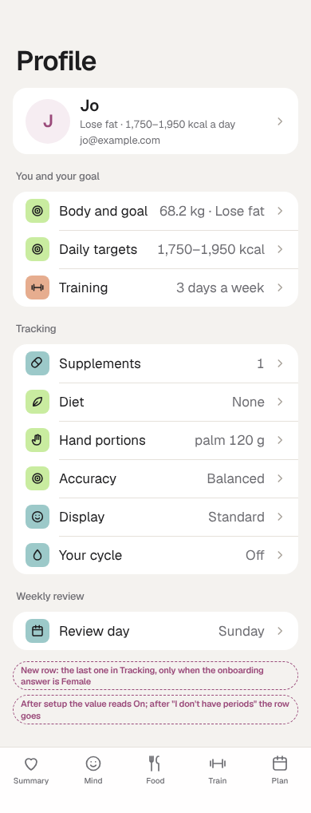

**A2 The offer: what Tali will and won't do; Set it up / Not now / I don't have periods** ([dark](cy-a2-intro-dark.png))

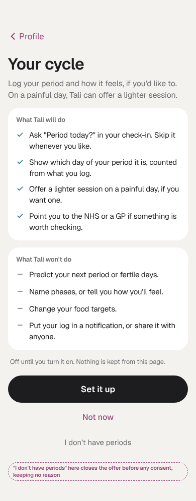

**A3 After "I don't have periods": no reason kept** ([dark](cy-a3-closed-dark.png))

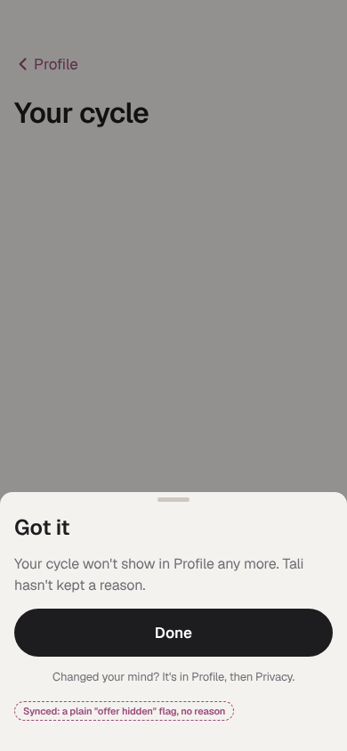

### B. Setup

**B1 Cycle consent: unticked, Continue disabled until ticked** ([dark](cy-b1-consent-dark.png))

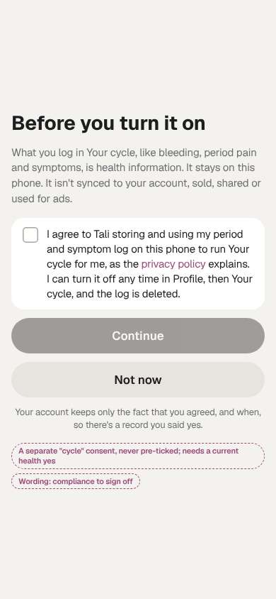

**B2 "Which fits you best?" (six answers)** ([dark](cy-b2-question-dark.png))

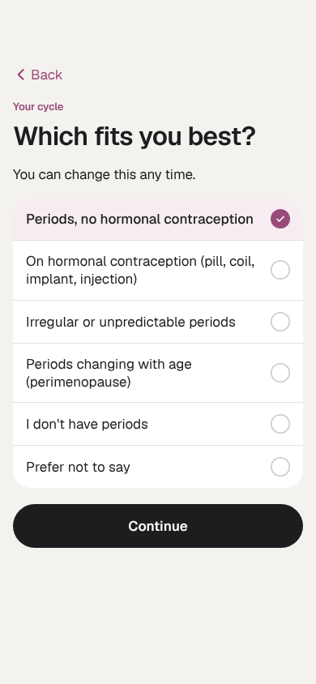

**B3 Here's how it works: "On this phone only"** ([dark](cy-b3-works-dark.png))

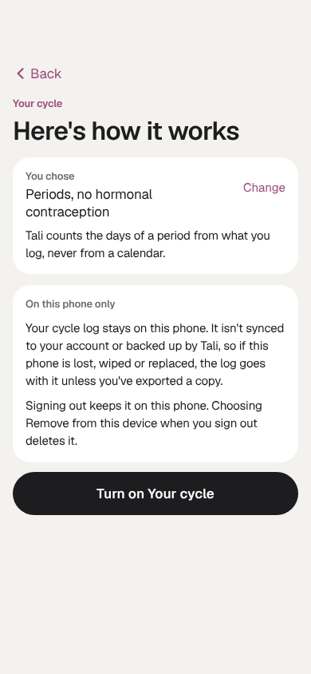

**B3b The line shown for each answer** ([dark](cy-b3b-lines-dark.png))

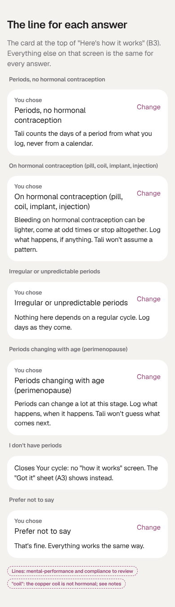

### C. Check-in

**C1 Check-in: one row, "Period today?"** ([dark](cy-c1-checkin-dark.png))

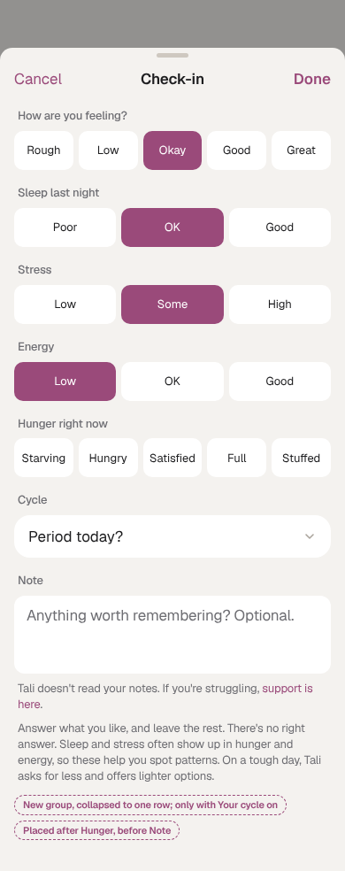

**C2 Check-in opened: bleeding, pain, symptoms** ([dark](cy-c2-checkin-open-dark.png))

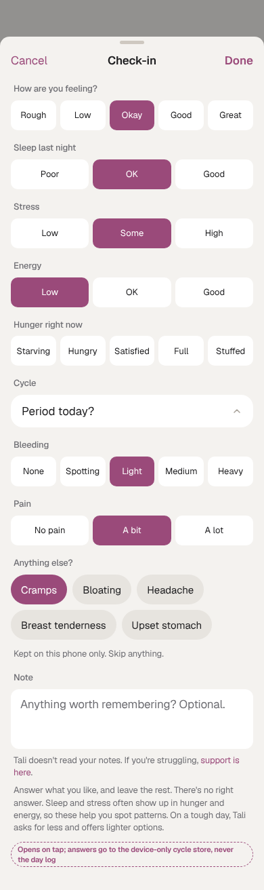

### D. Cycle page

**D1 Your cycle page: "Day 2 of your period"** ([dark](cy-d1-page-dark.png))

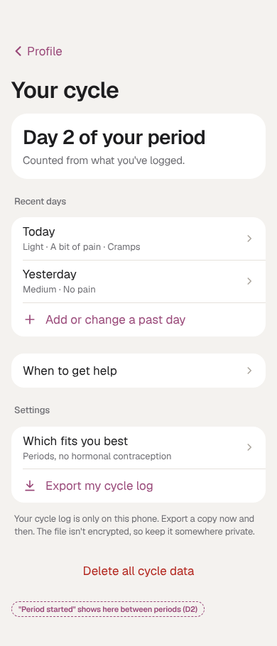

**D1g Gentle mode: no day number** ([dark](cy-d1g-page-gentle-dark.png))

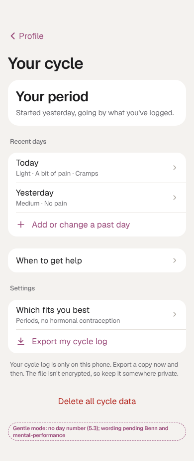

**D2 Between periods: "Period started"** ([dark](cy-d2-between-dark.png))

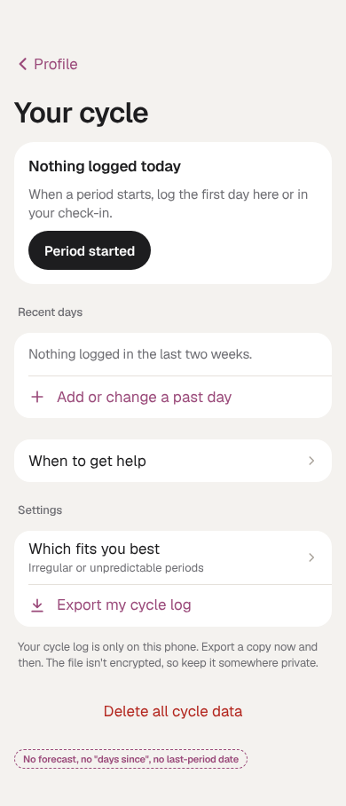

**D3 Add or change a past day** ([dark](cy-d3-day-dark.png))

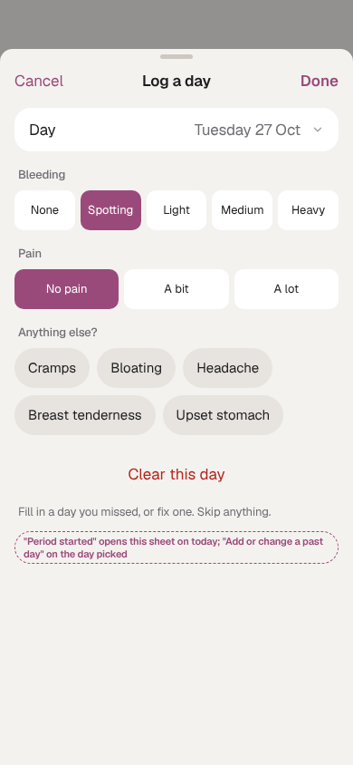

**D4 When to get help** ([dark](cy-d4-help-dark.png))

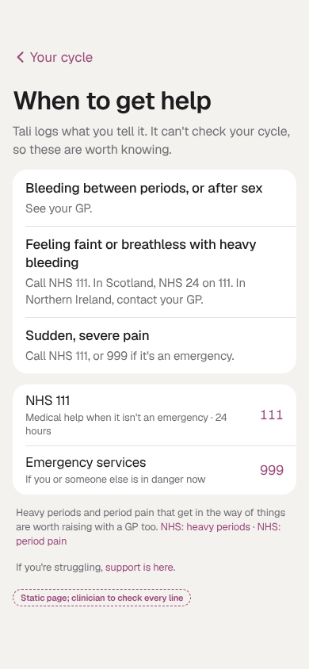

**D5 Delete all cycle data (export first)** ([dark](cy-d5-delete-dark.png))

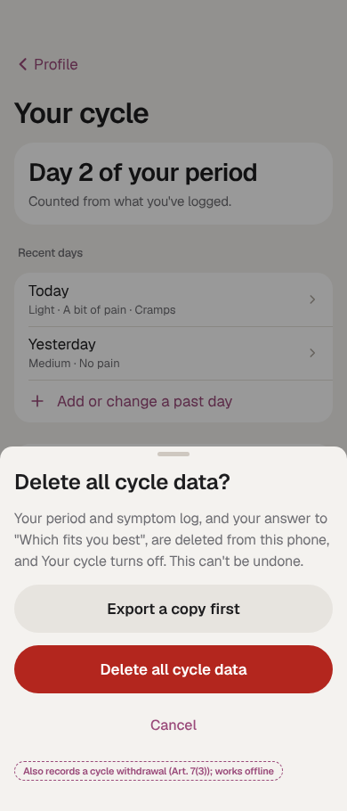

**D6 Profile › Privacy** ([dark](cy-d6-privacy-dark.png))

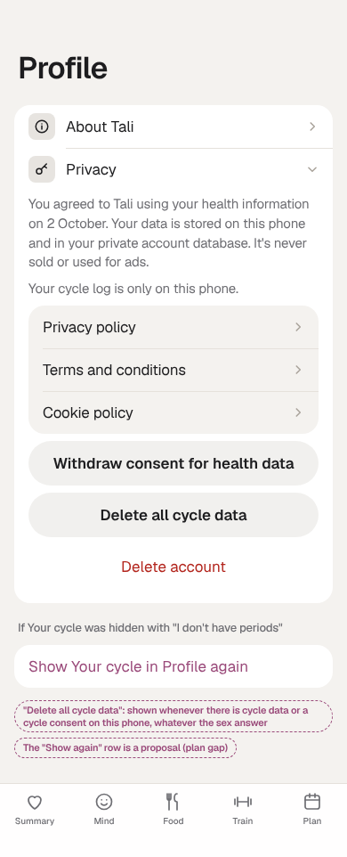

### E. Train

**E1 Train: the lighter offer on a pain "A lot" day** ([dark](cy-e1-train-dark.png))

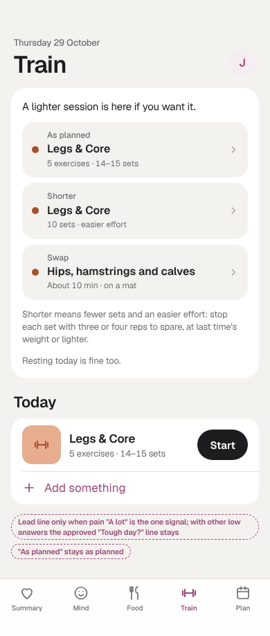

**E2 Summary wording unchanged** ([dark](cy-e2-summary-dark.png))

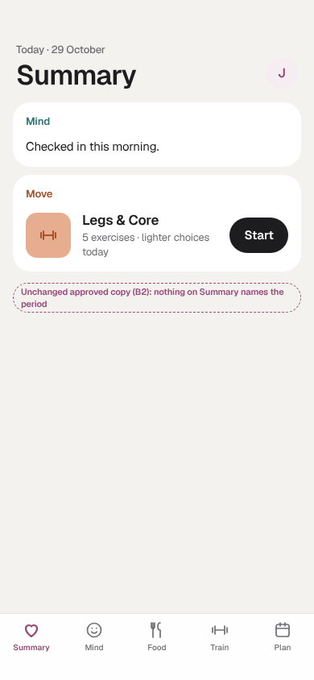

### F. Weigh-in

**F1 Your 4-week check: the weigh-in note** ([dark](cy-f1-check-dark.png))

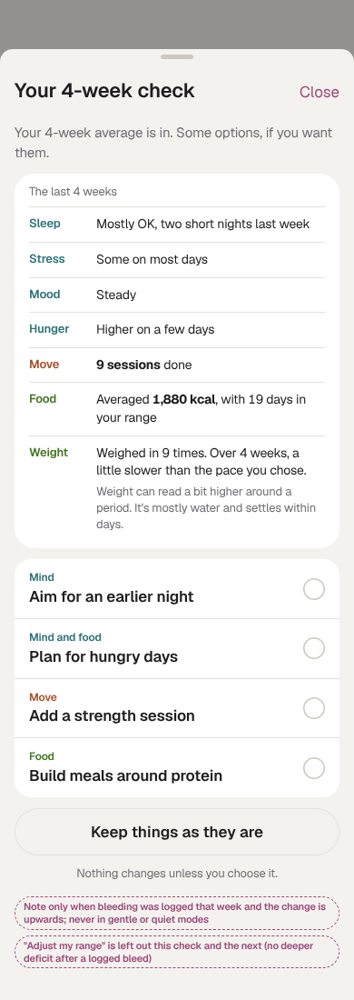

### G. Safety prompts

**G1 Safety: bleeding more than a week** ([dark](cy-g1-long-dark.png))

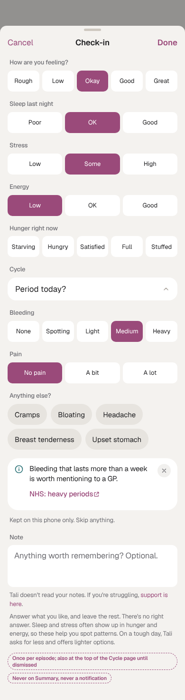

**G2 Safety: heavy periods, period pain** ([dark](cy-g2-prompts-dark.png))

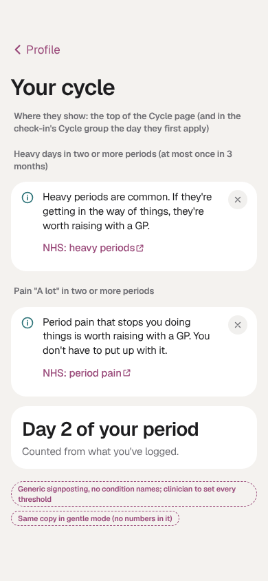

**G4 "Has a period come that isn't logged?"** ([dark](cy-g4-ask-dark.png))

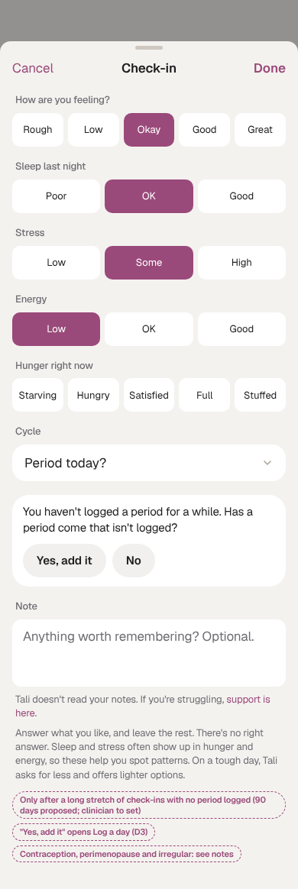

**G5 The reply after "No"** ([dark](cy-g5-answer-dark.png))

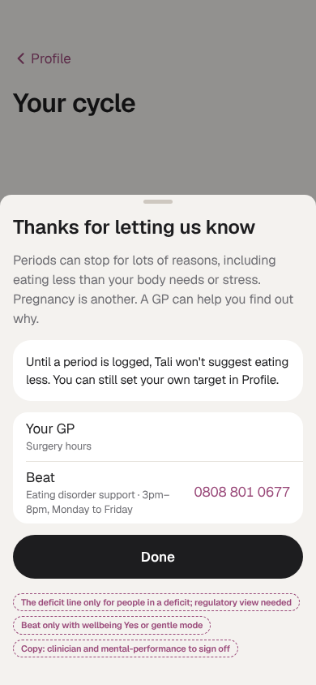
