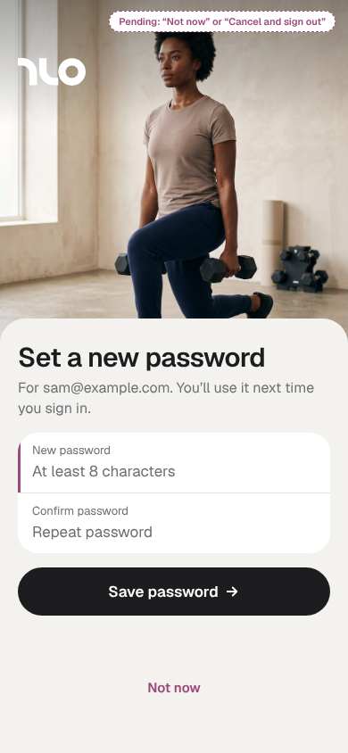
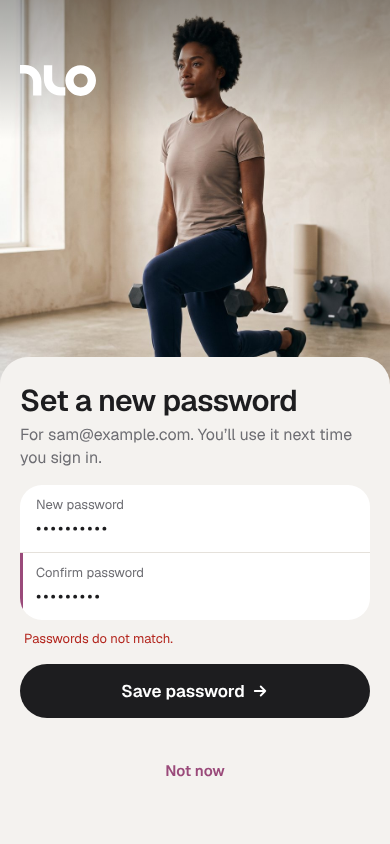
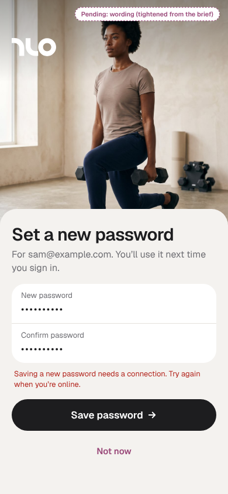
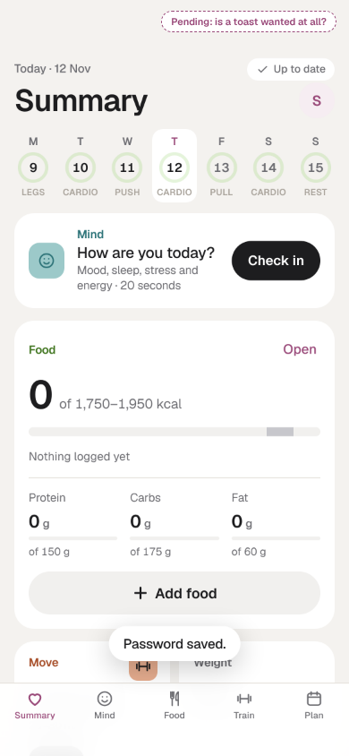
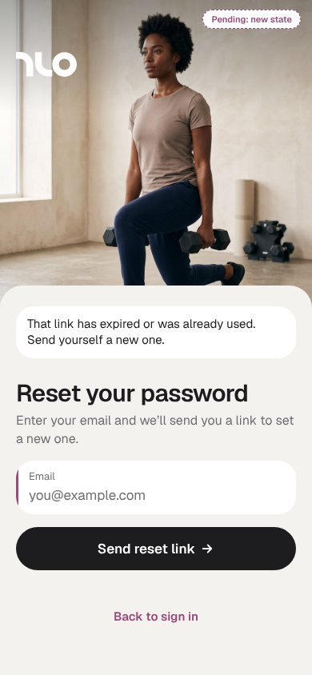

# Set a new password v1 boards (DRAFT, not approved)

**Status: draft for Benn's or Sara's review, 12 Nov 2026. Not approved: don't build from these.** Per CLAUDE.md, no design ships without Benn's or Sara's approval; when one of them approves or changes these boards, this folder is updated to match.

- Why: the reset link from "Forgot?" signs the person straight in with a recovery session. The app never handles Supabase's `PASSWORD_RECOVERY` event or calls `updateUser({ password })`, so nobody can set a new password, and an account that only uses Google can't add one. This adds one step.
- Built on the existing sign-in frame (`src/screens/AuthScreen.tsx`, the `auth2` styles in `src/styles/theme.css`), so it adds no new pattern.
- Live boards, with notes and both modes side by side: the claude.ai Design canvas, page "Set a new password (draft for Benn/Sara)": https://claude.ai/artifact/EYDHM6mLouqwPsWxcDsWEb (only people the canvas is shared with can open it)
- These PNGs are 390 px exports of the same boards, light and dark, drawn at an iPhone's 390 × 844 with its top and bottom safe areas. Dashed tags on a board mark items still pending.

## Open decisions for Benn or Sara

1. The foot link on board 1: "Not now" (keeps the person signed in and opens the app) or "Cancel and sign out".
2. Board 4: whether to show the toast "Password saved." at all, or land on Today with nothing.
3. Board 5 is a new state: a link that has expired or was already used opens "Reset your password" with a notice.
4. Board 3 wording: "Saving a new password needs a connection. Try again when you're online." (the brief said "You're offline. Connect to save your new password."; this one follows the app's other offline lines).

## Boards

**1 Set a new password: two fields, "Save password", "Not now"** ([dark](spw-1-set-dark.png))

**2 The passwords don't match** ([dark](spw-2-mismatch-dark.png))

**3 Offline: the button stays enabled** ([dark](spw-3-offline-dark.png))

**4 Saved: Today with the toast "Password saved."** ([dark](spw-4-saved-dark.png))

**5 The link has expired or was already used** ([dark](spw-5-expired-dark.png))

